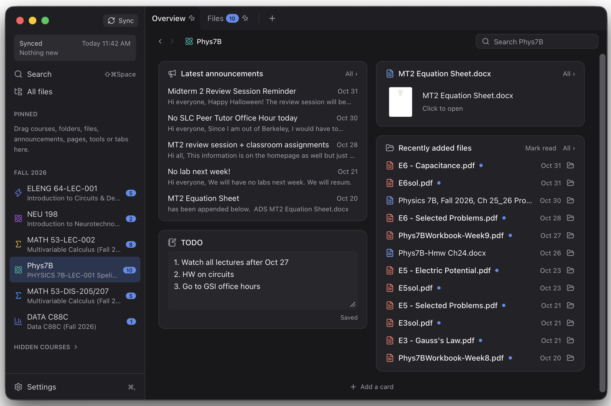
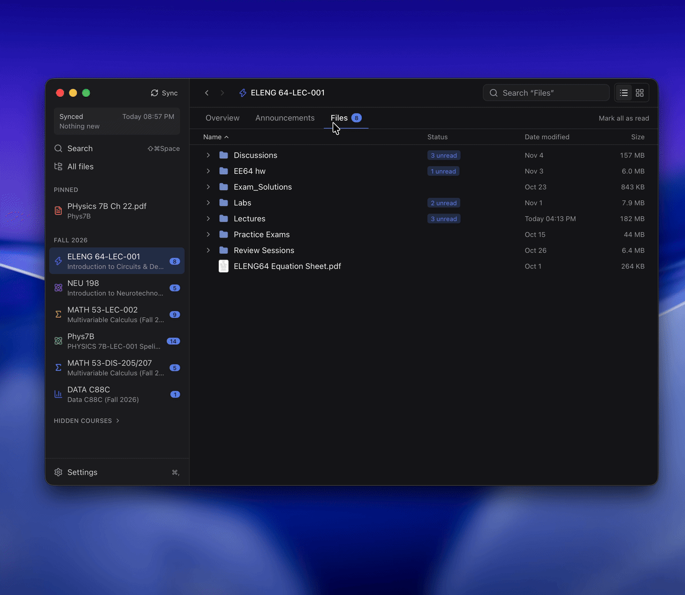
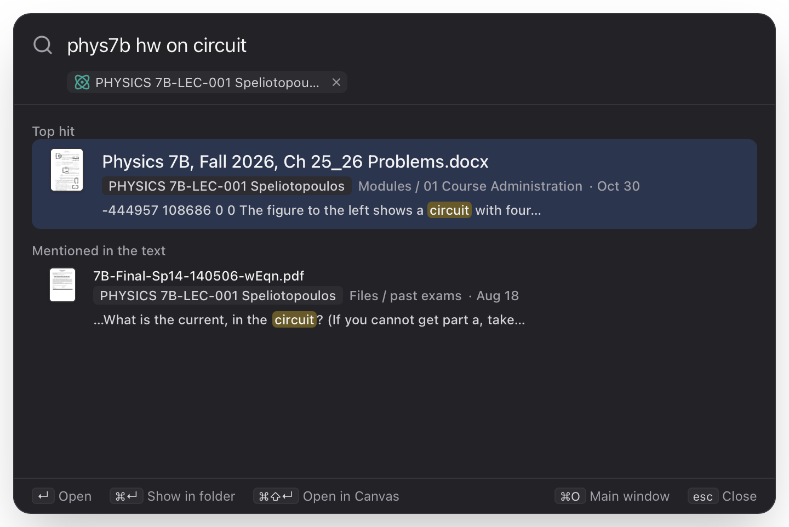
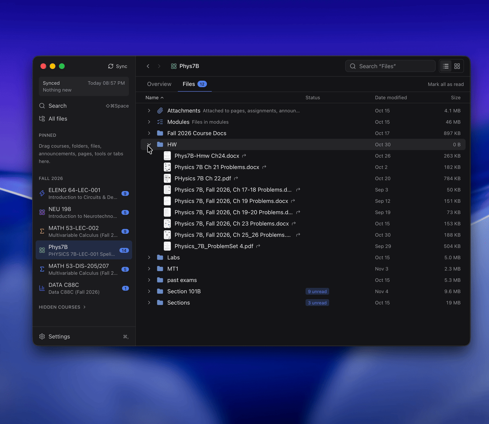
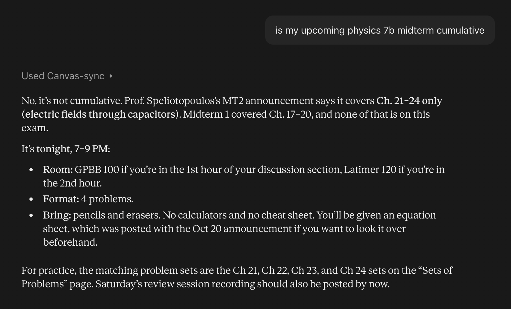

# Canvas Sync

**All your Canvas courses in one Desktop app.**



## What it does for you

### **Instant preview and local edits.**
 

*(20x faster than Canvas on your school's crappy eduroam)*


### **Powerful searching.** 


*Who would've guessed that this week's homework is in the "01 Course Administration" module?*


### **Pin what you use most.** 


*Drag anything (homework folder,  equation sheet, an assignment, an announcement) to *Pinned* at the top of the sidebar.*


### **See what's new.** 


*Instead of the default canvas home page (which your instructor creates at the beginning of the semester and forgets to update ever since), you have a customizable course dashboard for all the new information that you care about.*


### **Connect to a desktop LLM app.** 
   
*With one click in Settings, Claude or ChatGPT can read your synced courses and answer your questions.*


## Installation and set up

1. **Download** from this project's
   [Releases page](https://github.com/bzemerald/canvas_cli/releases).
2. **On Macs**, because I can't afford Apple's $99/yr developer account, it will say that the app is damaged and you should move it to trash. Ignore it by clicking "cancel," and go to your Mac's System Setttings → Privacy & Security, scroll down to the security section at the bottom, where you will see a notice that the app was blocked, then click "Open Anyway."
3. **Sign in to Canvas.** The app asks for three things:
   - **Your school's Canvas address**, the one in your browser when you use Canvas
     (e.g. `bcourses.berkeley.edu`).
   - **An access token**, which lets the app read Canvas as you. In Canvas, click **Account →
     Settings**, scroll to *Approved Integrations*, click **+ New Access Token**, give it any
     name, set its expiration date to as long as possible, 
and copy the long code it shows (it's only shown once) into the app.
   - **A folder** for your course files, e.g. a new folder called `Canvas` in your home folder.
4. If your Mac asks whether Canvas Sync may use your keychain, click **Always Allow**. That's
   where it keeps the token.
5. *(Optional)* EdStem: In Settings, connect to EdStem with a token made on Ed's *Settings → API Tokens* page.
6. *(Optional)* AI assistants: Settings → AI assistants → Link To… Allows your courses to be seen by Claude Desktop or ChatGPT Desktop(Work/Codex).

The first sync downloads all your courses' files, which can take a few minutes. After that it syncs when the app opens and every hour (both can be changed in Settings).


## The command line
The project also includes `canvas`, a command line tool. 

```sh
python3 -m venv .venv && .venv/bin/pip install -e '.[dev]'
.venv/bin/canvas init        
.venv/bin/canvas courses     
.venv/bin/canvas pull -n     # dry run
.venv/bin/canvas pull
```

| command | |
|---|---|
| `pull [PATH…] [-c COURSE] [-n] [-v] [--json]` | fetch new/changed files; with paths, only in those folders/files |
| `status [--json]` | your local edits / moves / deletions since the last pull (offline) |
| `restore PATH…` | put back the Canvas original of a file, or of everything you changed in a folder (your versions go to the Trash) |
| `search QUERY… [-n N] [-o N] [--json]` | search every course (offline), see below |
| `index` | update the search index (runs after every `pull`) |
| `open [COURSE]` | open in Finder |
| `serve [--port N]` | the local API the desktop app uses |
| `mcp` | your courses for an AI assistant, over MCP (see below) |

## Search

`canvas search 221 mt` searches file names, folder names, the text inside PDFs, Office files
and notebooks, and every page, assignment, announcement and syllabus (and Ed post).

- Words that name a course become a filter: `221`, `math221`, `cs70` (for COMPSCI 70),
  the start of the course name, or your own `[course_aliases]`.
- Abbreviations expand both ways: `mt` ↔ midterm, `hw` ↔ homework / problem set,
  `sol` ↔ solution, … Add your own under `[search.abbreviations]`.
- `mt1` finds "MT1.pdf", "Midterm 1 Solutions" and "midterm1.pdf" alike.
- Results whose name or folder matches come first; files that only mention it inside follow.
- `--open N` opens result N (the file, or the Canvas page).

The index is `.canvas/index.db`, a cache: delete it and `canvas index` rebuilds it.

## AI assistants (MCP)

`canvas mcp` serves what's synced to an AI assistant (Claude Desktop, Claude Code, Cursor...)
over the Model Context Protocol, on stdin and stdout. The assistant can search everything,
read documents and files (PDFs, slides... as text), see what's due, what's new, grades, modules,
folders, and what you changed locally.

It's read-only and offline: nothing is fetched from Canvas or Ed, nothing is marked read, no
setting changes; what's newer than the last sync isn't there (`whats_new` says when that was).
Paths stay inside the sync folder, and `.canvas/` and the tokens are never handed over.

In the app, Settings → AI assistants → Add To… adds it to the AI apps found on this computer
(Claude, Codex), and takes it away again. Their config files keep everything else in them (the
old one is kept in `~/.config/canvas-sync/backups/`). Other apps are added by hand, as below.
When Canvas Sync moves or is reinstalled, entries pointing at
the old place are pointed at the new one when it starts. ChatGPT only connects to servers on the
web, so it can't use this yet.

By hand, `canvas-sync` being the server's name:

```sh
claude mcp add --scope user canvas-sync -- /path/to/canvas-sync/.venv/bin/canvas mcp   # Claude Code
```

```json
{"mcpServers": {"canvas-sync": {"command": "/path/to/canvas-sync/.venv/bin/canvas", "args": ["mcp"]}}}
```

| tool | |
|---|---|
| `list_courses` | your courses: code, name, term, what's new, last synced |
| `search` | everything, as the app's search finds it; by course, kind, dates, source (Ed) |
| `read` | one document's whole text (with Ed replies), or a file's, in parts |
| `list_items`, `course_overview`, `modules`, `grades` | a course, as its tabs show it |
| `upcoming` | what's due in the next days, with Canvas's status |
| `whats_new` | what you haven't opened, or everything since a time; and how the last sync went |
| `list_files`, `local_changes` | folders, and what you changed on this computer |


## Launching/building the desktop app from source

```sh
python3 -m venv .venv && .venv/bin/pip install -e '.[dev]'
cd app && npm install        # and Rust, from https://rustup.rs
npm run tauri dev            # the app starts .venv/bin/canvas serve itself
```

The first launch asks for your Canvas address, an access token and the sync folder. The app then syncs on launch and every hour (you can change both in Settings). See [app/README.md](app/README.md) for how the shell and backend fit together.

To build the app as a standalone, in `app/`:

```sh
npm run bundle 
```

This packs the Python backend with PyInstaller into the app (`npm run build:backend` does that
part alone), so the app doesn't need this repo or its `.venv`. `npm run tauri build` makes
one without it, which starts the repo's `.venv/bin/canvas`. It isn't signed with a developer
ID: on another Mac, open it the first time with right-click → Open. The packed backend is a new
program to the Keychain, so macOS may ask before it reads the Canvas token (Always Allow), and
again after a rebuild.

## What ends up on disk

```
~/Canvas/
  .canvas/
    config.toml                     ← layout, sync policies, the app's arrangement; edit freely
    notes/                          ← notes typed on a course's overview in the app
    state.db                        ← what we know (SQLite)
    index.db                        ← the search index
    originals/                      ← pristine copies (APFS clones: ~no extra space)
~/.config/canvas-sync/
  config.toml                       ← which Canvas, which sync folder; your Ed region
  app.toml                          ← the app's preferences, the default tabs and overview
```

Canvas and Ed tokens are in the keychain.

In `.canvas/config.toml`, besides the sync settings:

- `[[pinned]]` is the sidebar's Pinned, each entry a thing of any kind.
- `[course_layouts.<id>]` is a course's page as you arranged it: its `tabs`, `overview` and
  `links`, each a list of the course's own things (and web links), with your name for each
  and whether it's hidden.
- `[ed.courses]` says which Ed course each course is (0: none).

## How your changes are treated

| you… | next `pull` |
|---|---|
| edit a file | kept. If Canvas also changed it: your copy becomes `name (mine).pdf`, the new version takes its place (`sync.on_conflict`) |
| delete a file | not downloaded again (`sync.on_local_delete`); `canvas restore` brings it back |
| move/rename a file in Finder | remembered; future updates go to the new spot (`sync.on_local_move`) |
| rename a folder in the app | remembered in `[folder_names]`; what Canvas adds to it later still goes there, links into it are updated (renaming in Finder only counts as moving the files) |
| delete in the app | to the Trash; files from Canvas aren't downloaded again (restorable). A deleted folder can also stop what Canvas adds to it later (`skip_folders`) |
| stop syncing in the app | the file or folder stays as your own; Canvas updates no longer touch it, new files in a folder aren't downloaded, and the shortcuts in it stay, until you resume (resuming a folder inside one that isn't synced resumes the way to it) |

Files removed from Canvas are kept locally (`sync.on_remote_delete`). An instructor
re-uploading a file (Canvas gives it a new id) is treated as an update, not a new file.

`[[rules]]` in `config.toml` put matching files somewhere else, e.g. every
`files/Lecture Slides/*.pdf` into `Slides/`, or skip them.

## Code map

The CLI is a thin shell; everything goes through `Engine`, which the app's backend
(`server.py`) uses too. In `src/canvas_sync/`:

```
api.py       Canvas REST client: pagination, rate-limit backoff, downloads
discover.py  course → every file + where it appears (CourseSnapshot)
layout.py    file → local path(s). Pure: pins > rules > views
plan.py      remote vs. original vs. disk → list of Actions (nothing is changed)
execute.py   carries out a Plan
engine.py    the public API: courses(), plan(scope), apply(), status(), restore(), list_dir(), search(), find()
sync.py      what a sync does after Canvas: Ed, the index, passages for searching by meaning
state.py     .canvas/state.db: schema and access
config.py    config.toml and app.toml (written with tomlkit, so comments survive)
text.py      text out of PDFs, Office files, notebooks, HTML
search.py    .canvas/index.db (SQLite FTS5): the text inside, and finding it
meaning.py   search by meaning (an English embedding model, optional)
catalog.py   everything search can go to by name
ed.py        Ed: its API (read-only), matching Ed courses to Canvas courses, posts as documents
things.py    what can be put somewhere (a thing), and how it's written down
places.py    the places (Pinned; a course's tabs, overview, tools and links) and their rules
content.py   what the app shows: overview, items, modules, tools
browse.py    a folder as the app shows it: disk + Canvas status, links, deleted files
thumbs.py    preview images for the app's icon view
server.py    local HTTP API for the desktop app (`canvas serve`)
agent.py     your courses for an AI assistant, over MCP (`canvas mcp`): read-only
assistants.py  AI apps it's added to (their config files), and keeping them pointed at it
cli.py       `canvas` command
```

The app (Tauri v2, React, TypeScript) is in `app/`.

## Tests

```sh
.venv/bin/python -m pytest -q tests     # against a fake Canvas (tests/fake_canvas.py) and a fake Ed
cd app && npx tsc --noEmit -p . && npm test && npm run check:i18n
```
